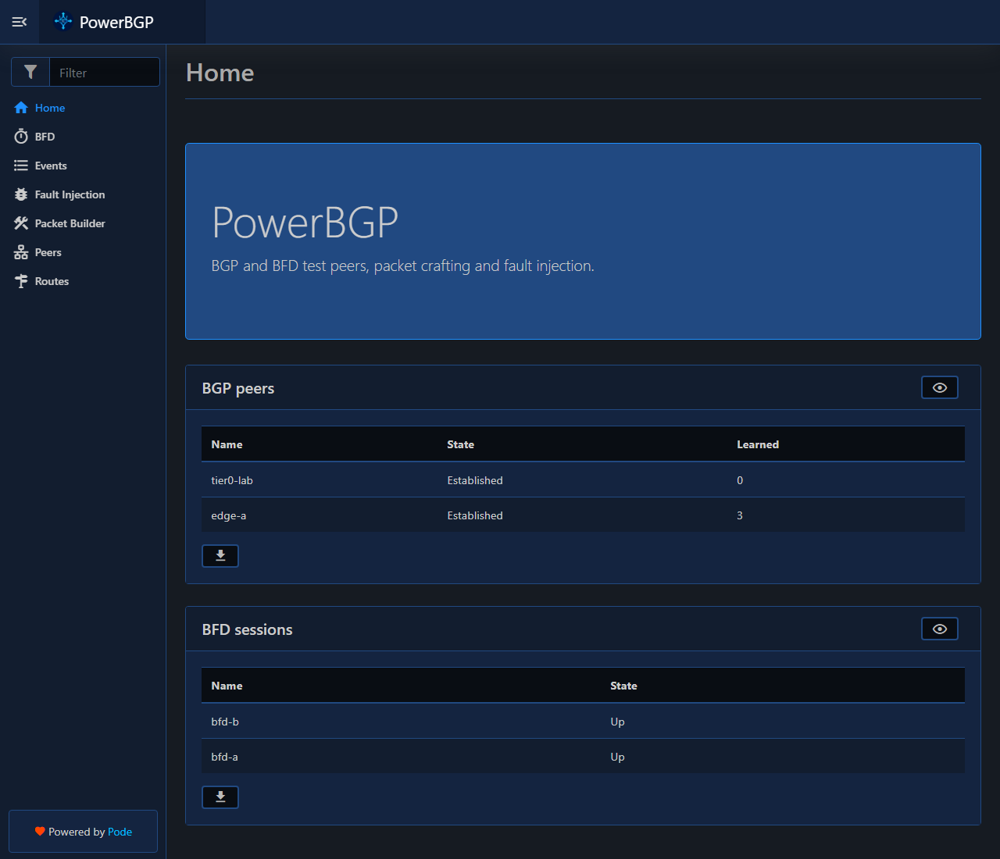

# 🛰️ PowerBGP.Pode

Pode.Web UI and REST API for the [PowerBGP](../PowerBGP) module.



Requires Pode 2.12.0 and Pode.Web 0.8.3. `server.ps1` expects the PowerBGP repo cloned next to this one (`../PowerBGP`).

```powershell
pwsh ./server.ps1            # http://localhost:8085
pwsh ./server.ps1 -Address 0.0.0.0
```

## 🔌 REST API and OpenAPI

The REST API lives under `/api/bgp/*` and `/api/bfd/*`. The OpenAPI 3.0 spec is served at `/docs/openapi`, with Swagger UI at `/docs/swagger` and ReDoc at `/docs/redoc`. Peer create/edit accept `LocalAddress`, `AddressFamily`, `InboundFilter` and `InboundDefault`. There is no authentication, so use it in a lab only.

## 🐳 Docker (Linux, enables TCP-MD5)

From the parent folder containing both repos:

```
docker build -f PowerBGP.Pode/Dockerfile -t powerbgp .
docker run --rm --network host powerbgp
```

There is no API authentication; do not expose the port to untrusted networks.
